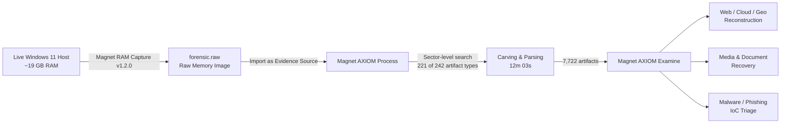
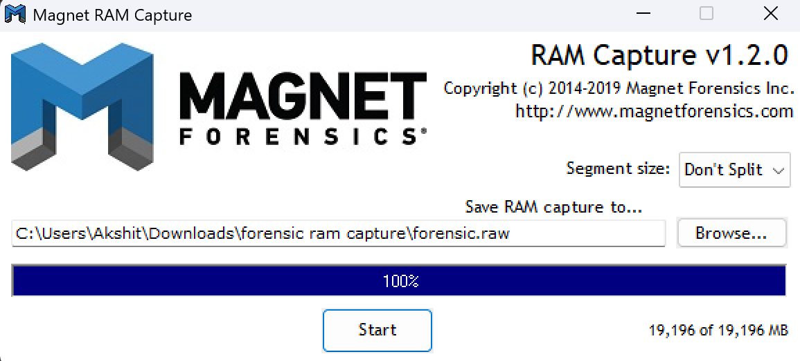
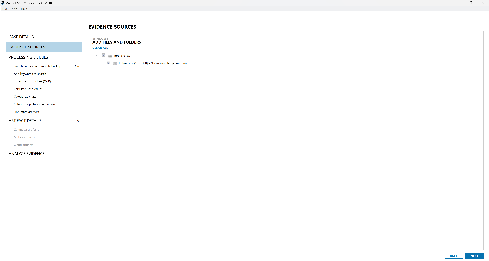

# Windows RAM Forensics — Volatile Memory Acquisition & Analysis with Magnet AXIOM


> A documented, end-to-end **live RAM (volatile memory) forensic investigation** on a Windows 11 x64 host — from memory acquisition with **Magnet RAM Capture**, through processing in **Magnet AXIOM Process**, to artifact analysis in **Magnet AXIOM Examine**. The exercise reconstructs user web activity, cloud and geolocation traces, recovered media, and in-memory indicators of compromise (IoCs) from a single `.raw` memory image.

This repository is a **forensic lab write-up / portfolio project** produced as part of **EC-Council CHFI (Computer Hacking Forensic Investigator)** preparation. It is intended for **educational and defensive security** purposes only.

<p align="center">
  
  <br>
  <em>Magnet AXIOM Examine — case dashboard: 7,722 artifacts recovered from a single ~19 GB RAM image.</em>
</p>

---

## 📌 Table of Contents

- [Executive Summary](#-executive-summary)
- [Objectives](#-objectives)
- [Lab Environment & Toolchain](#-lab-environment--toolchain)
- [Investigation Workflow](#-investigation-workflow)
- [Key Findings at a Glance](#-key-findings-at-a-glance)
- [Artifact Breakdown](#-artifact-breakdown)
- [Indicators of Compromise (IoCs)](#-indicators-of-compromise-iocs)
- [Repository Structure](#-repository-structure)
- [Documentation Index](#-documentation-index)
- [CHFI Domain Mapping](#-chfi-domain-mapping)
- [Disclaimer](#-disclaimer)
- [License](#-license)

---

## 🧭 Executive Summary

Volatile memory (RAM) holds a rich, ephemeral record of system state that never touches disk — active browser sessions, decrypted content, cached media, network artifacts, and running-process remnants. In a post-breach or insider-threat scenario, capturing this data **before power-off** is often the difference between a complete and an incomplete investigation.

In this exercise a **~19 GB live memory image** was acquired from an active Windows 11 system and parsed with Magnet AXIOM. Processing completed in **12 minutes 3 seconds** and surfaced **7,722 artifacts**, of which **5,067 were web-related**. Analysis reconstructed browser history, cloud-storage access, Google Maps geolocation queries, social-media activity, recovered images, and **2 malware/phishing URLs** resident in memory.

---

## 🎯 Objectives

- Perform forensically sound **acquisition of volatile memory** from a live Windows host.
- Process a raw memory image at **sector level** using an industry-standard DFIR suite.
- **Reconstruct user activity** (web, cloud, geolocation, social, media) purely from RAM.
- **Identify in-memory IoCs** — malware / phishing / redirect URLs with no disk footprint.
- Produce **repeatable, documented methodology** aligned with CHFI investigative domains.

---

## 🧰 Lab Environment & Toolchain

| Component | Detail |
|---|---|
| **Target host** | Windows 11 Home Single Language x64 (live, powered-on system) |
| **Physical memory** | 19,196 MB (~19 GB) |
| **Acquisition tool** | Magnet RAM Capture v1.2.0 |
| **Image format** | Raw (`forensic.raw`), segment size *Don't Split* |
| **Image size** | ~18.75 GB (acquired as a single contiguous image) |
| **Processing tool** | Magnet AXIOM Process v5.4.0.26185 |
| **Analysis tool** | Magnet AXIOM Examine v5.4.0.26185 |
| **Case type** | Data exfiltration / IP theft |
| **Search type** | Sector level (no known file system — treated as raw physical media) |
| **Examiner** | Akshit |

---

## 🔬 Investigation Workflow



<p align="center">
  
  
  <br>
  <em>Left: live RAM capture complete (19,196 MB → <code>forensic.raw</code>). Right: image ingested into AXIOM — "No known file system found," handled as raw media.</em>
</p>

**Phase summary** (full detail in [`/docs`](docs)):

1. **Acquisition** — Captured live RAM to `forensic.raw` with Magnet RAM Capture (100% of 19,196 MB). → [02-memory-acquisition.md](docs/02-memory-acquisition.md)
2. **Case setup** — Created Case #1 (*Data exfiltration / IP theft*) in AXIOM Process, examiner *Akshit*.
3. **Evidence ingest** — Added the raw image as a **Computer → Windows → Image** source; AXIOM reported *"Entire Disk (18.75 GB) — No known file system found,"* so a **Sector-level** search was selected.
4. **Artifact selection** — Enabled **221 of 242** computer artifact categories (cloud, comms, documents, email, location, media, social, OS, web). → [03-axiom-processing.md](docs/03-axiom-processing.md)
5. **Processing** — Sector-level carve completed in **12m 03s** with **0 exceptions**.
6. **Analysis** — Triaged results in AXIOM Examine across refined-result categories. → [04-findings-and-analysis.md](docs/04-findings-and-analysis.md)
7. **IoC review** — Isolated and documented malware/phishing indicators. → [05-indicators-of-compromise.md](docs/05-indicators-of-compromise.md)

---

## 📊 Key Findings at a Glance

| Metric | Value |
|---|---|
| **Total artifacts recovered** | **7,722** |
| Web-related artifacts | 5,067 |
| Refined results | 1,186 |
| Operating-system artifacts | 1,059 |
| Media artifacts | 296 |
| Location & travel artifacts | 101 |
| Classified URLs | 184 |
| Google Maps geolocation queries | 79 |
| Google searches | 399 |
| Social-media URLs | 348 |
| Cloud-services URLs | 14 |
| Recovered pictures | 286 |
| **Malware / phishing URLs** | **2** |
| Processing duration | 12m 03s (0 exceptions) |

---

## 🧩 Artifact Breakdown

### Refined Results (`1,186`)

| Category | Count | Evidentiary value |
|---|---:|---|
| Classified URLs | 184 | E-commerce, account, and service URLs (e.g., Amazon, AWS console sessions) |
| Google Searches | 399 | User intent & search history |
| Social Media URLs | 348 | LinkedIn job/profile activity, other platforms |
| Google Maps Queries | 79 | Geolocation / movement intelligence (New Delhi coordinates) |
| Parsed Search Queries | 77 | Reconstructed query strings |
| Identifiers – Device | 48 | Device-level identifiers |
| Locally Accessed Files & Folders | 23 | File-interaction evidence |
| Cloud Services URLs | 14 | Google Drive, OneDrive access |
| Web Chat URLs | 7 | Chat/messaging fragments |
| Identifiers – People | 5 | Email / person identifiers |
| **Malware / Phishing URLs** | **2** | **In-memory IoCs** |

### Web-Related (`5,067`)

| Source | Count |
|---|---:|
| WebKit Browser Web History (Carved) | 2,599 |
| Potential Browser Activity | 2,371 |
| Edge / Internet Explorer 10–11 Content | 43 |
| Firefox SessionStore Artifacts | 31 |
| Edge / IE 10–11 Main History | 22 |
| Edge / IE 10–11 Daily/Weekly History | 1 |

### Media (`296`)

| Type | Count |
|---|---:|
| Pictures | 286 |
| Carved Audio | 7 |
| Videos | 2 |
| Photoshop Files | 1 |

> Media was recovered via **carving** from unallocated physical sectors, with full MD5/SHA-1 hashing per artifact.

<p align="center">
  
  <br>
  <em>Classified URLs (184) — carved browser history with timestamps and physical-sector offsets.</em>
</p>

<p align="center">
  
  <br>
  <em>Google Maps queries (79) — coordinates and resolved addresses clustering around New Delhi.</em>
</p>

<p align="center">
  
  <br>
  <em>Social-media URLs (348) — predominantly LinkedIn job-search and profile activity.</em>
</p>

<p align="center">
  
  <br>
  <em>Recovered pictures (286) — carved from physical sectors with MD5/SHA-1 hashing.</em>
</p>

---

## 🚨 Indicators of Compromise (IoCs)

Two suspicious URLs were recovered from memory and classified by AXIOM as **Malware/Phishing URLs**:

| # | Indicator | Type | Observation |
|---|---|---|---|
| 1 | `hxxp://rep4.upseek[.]org/?r2=launc1\|hxxp://` | Redirect / suspicious | Chained/stacked URL with redirect parameters resident in browser memory |
| 2 | `hxxp://fewfwe[.]net/` | Suspicious domain | Low-reputation domain present in volatile browser activity |

<p align="center">
  
  <br>
  <em>Two memory-resident malware/phishing URLs flagged under Refined Results. Indicators defanged above for safety.</em>
</p>

> ⚠️ **Defanged** for safety. Full context and analysis: [05-indicators-of-compromise.md](docs/05-indicators-of-compromise.md)

---

## 🗂 Repository Structure

```
.
├── README.md                          # This file — project overview
├── LICENSE                            # MIT License
├── .gitignore                         # Excludes raw images & sensitive evidence
├── docs/
│   ├── 01-case-overview.md            # Scenario, scope, assumptions
│   ├── 02-memory-acquisition.md       # RAM capture methodology
│   ├── 03-axiom-processing.md         # Case setup & processing configuration
│   ├── 04-findings-and-analysis.md    # Full artifact analysis
│   └── 05-indicators-of-compromise.md # IoC triage & recommendations
├── reports/
│   └── forensic-report.md             # Formal investigation report
└── assets/
    └── screenshots/                   # 27 annotated evidence screenshots (01–27)
```

---

## 📚 Documentation Index

| Document | Description |
|---|---|
| [01 — Case Overview](docs/01-case-overview.md) | Scenario, scope, legal/ethical framing |
| [02 — Memory Acquisition](docs/02-memory-acquisition.md) | Live RAM capture procedure & integrity notes |
| [03 — AXIOM Processing](docs/03-axiom-processing.md) | Case creation, evidence ingest, processing options |
| [04 — Findings & Analysis](docs/04-findings-and-analysis.md) | Category-by-category artifact analysis |
| [05 — Indicators of Compromise](docs/05-indicators-of-compromise.md) | IoC details, defanged, with recommendations |
| [Forensic Report](reports/forensic-report.md) | Formal, report-style deliverable |

---

## 🎓 Domain Mapping

| Domain                                        | Demonstrated in this project                            |
| --------------------------------------------- | ------------------------------------------------------- |
| Digital Evidence & First Responder Procedures | Volatile-data-first acquisition on a live host          |
| Data Acquisition & Duplication                | Raw memory imaging with a validated tool                |
| Volatile Data Acquisition                     | Core focus — full RAM capture & parsing                 |
| Windows Forensics                             | Windows 11 memory artifact reconstruction               |
| Web & Browser Forensics                       | Reconstruction of WebKit/Edge/Firefox activity from RAM |
| Malware / IoC Analysis                        | In-memory malware & phishing URL triage                 |
| Investigation Reporting                       | Documented, repeatable, report-ready output             |

---

## ⚖️ Disclaimer

This project was conducted on a **system owned and controlled by the author**, in a **controlled lab environment**, for **educational and professional-development purposes** (CHFI preparation). All personally identifiable and sensitive data in the screenshots has been **redacted**. Malicious indicators are **defanged**.

Nothing in this repository should be used to access systems or data without explicit authorization. The author accepts no liability for misuse.

---

## 📄 License

Released under the [MIT License](LICENSE). Tool names and logos (Magnet RAM Capture, Magnet AXIOM) are trademarks of **Magnet Forensics**; they are referenced here for educational description only and this project is not affiliated with or endorsed by Magnet Forensics.
