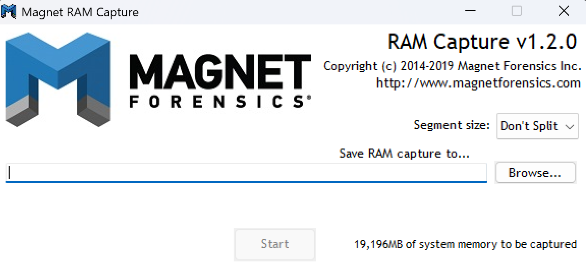
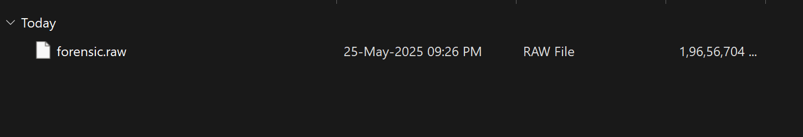

# 02 — Memory Acquisition

Acquisition of volatile memory from the live Windows 11 host using **Magnet RAM Capture v1.2.0**, a lightweight, low-footprint imaging tool designed to minimize the amount of data overwritten in memory during capture.

## Tool rationale

| Requirement | How Magnet RAM Capture meets it |
|---|---|
| Minimal memory footprint | Small, single-purpose executable — limits overwrite of evidence |
| Raw output | Produces a flat `.raw` physical memory image |
| Full-range capture | Captures the entire addressable physical memory |
| Examiner-friendly | Simple, auditable, single-action capture |

## Procedure

1. **Launch** Magnet RAM Capture on the live target with administrative privileges.
   - Tool reports **`19,196 MB of system memory to be captured`**.

*Magnet RAM Capture v1.2.0 — ready to image 19,196 MB of physical memory.*

2. **Configure output**
   - Segment size: **Don't Split** (single contiguous image).
   - Destination: `C:\Users\Akshit\Downloads\forensic ram capture\forensic.raw`.
3. **Start capture** and allow it to run to completion.
   - Progress reached **100% (19,196 of 19,196 MB)**.

*Capture complete — full memory range written to `forensic.raw`.*

4. **Verify the output file**
   - `forensic.raw` — **RAW File**, ~18.75 GB, created 25-May-2025.

*The acquired image on disk — a single raw memory file.*

## Acquisition summary

| Attribute | Value |
|---|---|
| Source | Live physical memory (Windows 11 x64) |
| Reported memory size | 19,196 MB (~19 GB) |
| Output file | `forensic.raw` |
| Format | Raw / flat physical memory image |
| Segmentation | None (single image) |
| Acquired size | ~18.75 GB |
| Date | 25-May-2025 |

## Integrity & handling notes

- A raw memory image has **no file system**; downstream tools must treat it as **raw physical media** and carve at the **sector level**.
- **Best practice** (recommended for real casework): generate and record a cryptographic hash (MD5/SHA-256) of the image immediately after acquisition, store the image **write-protected**, and work only from a **verified working copy** to preserve the original.
- AXIOM independently hashes individual recovered artifacts (MD5/SHA-1) during processing, supporting per-artifact integrity.

*Per-artifact MD5/SHA-1 hashing applied automatically by AXIOM during processing.*

> ➡️ Next: [03 — AXIOM Processing](03-axiom-processing.md)
