# 03 — AXIOM Processing

Ingesting and processing `forensic.raw` with **Magnet AXIOM Process v5.4.0.26185**. This phase converts the raw memory image into a structured, searchable artifact set for examination.

## Step 1 — Create the case

Launched AXIOM Process and selected **CREATE NEW CASE**.

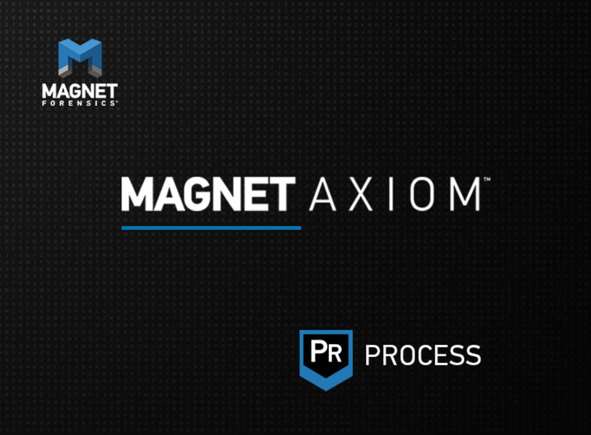
*Magnet AXIOM Process v5.4.0.26185 starting up.*

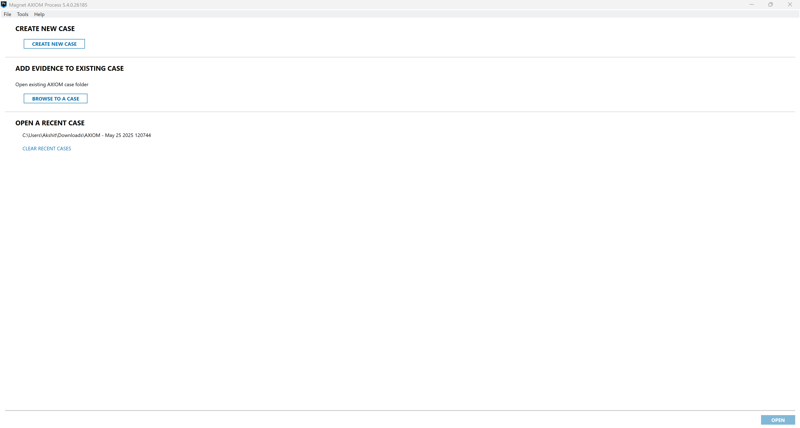
*AXIOM Process landing screen — starting a new case.*

### Case details

| Field | Value |
|---|---|
| Case number | 1 |
| Case type | Data exfiltration / IP theft |
| Scanned by | Akshit |
| Scan description | RAM Forensic |
| Case file location | `C:\Users\Akshit\Downloads\magnet axiom process` |

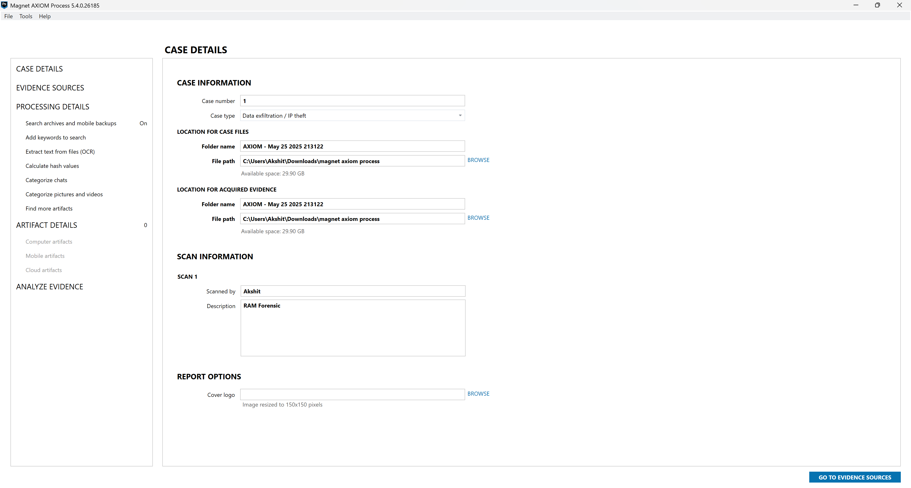
*Case details — Case #1, type "Data exfiltration / IP theft," scan description "RAM Forensic."*

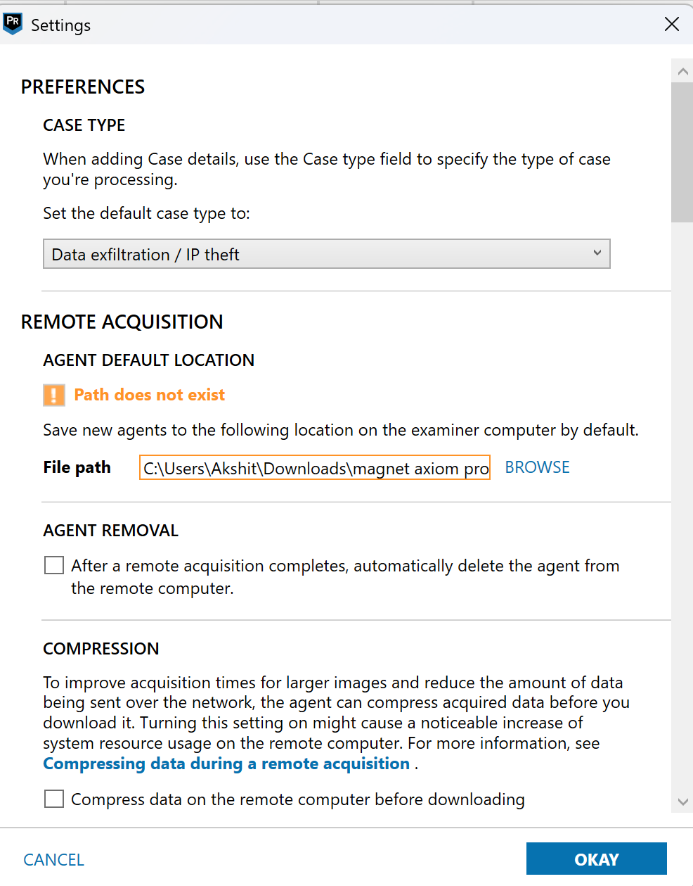
*Preferences — default case type configured as "Data exfiltration / IP theft."*

## Step 2 — Add the evidence source

Evidence-source selection path:

```
Evidence Source → COMPUTER → WINDOWS → IMAGE → forensic.raw
```

| Screen | Choice |
|---|---|
| Select evidence source | **Computer** |
| Select OS | **Windows** |
| Select source type | **Image** |
| Add files | `forensic.raw` → *Entire Disk (18.75 GB) — No known file system found* |

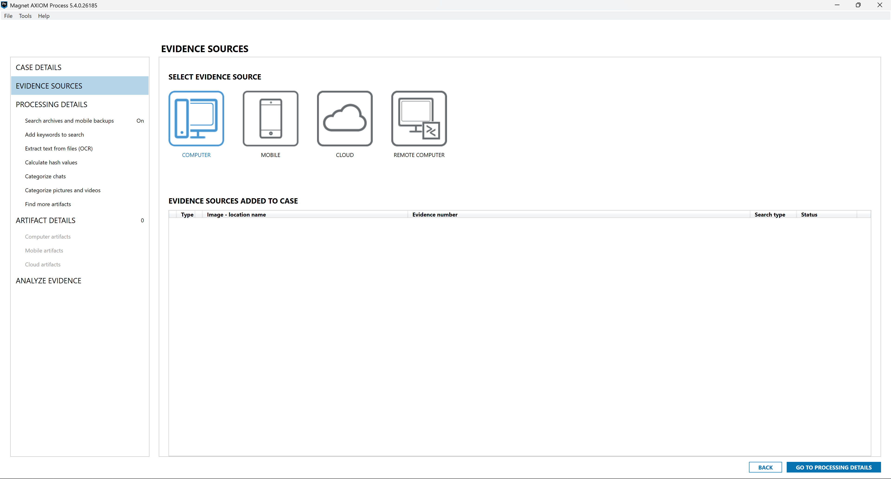
*Evidence source type — **Computer** selected.*

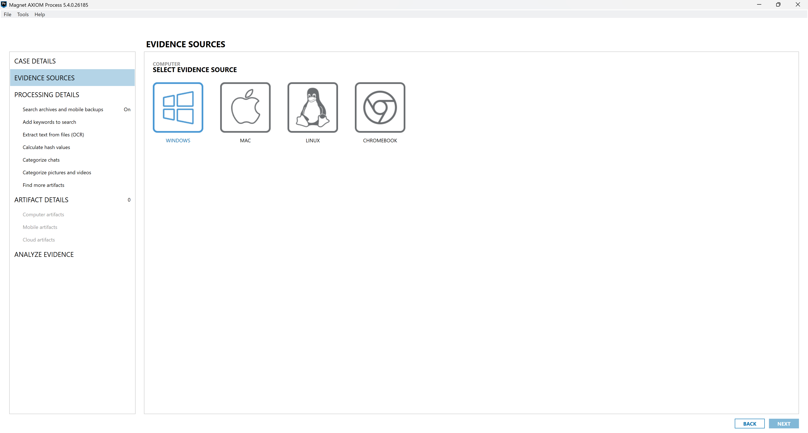
*Operating system — **Windows**.*

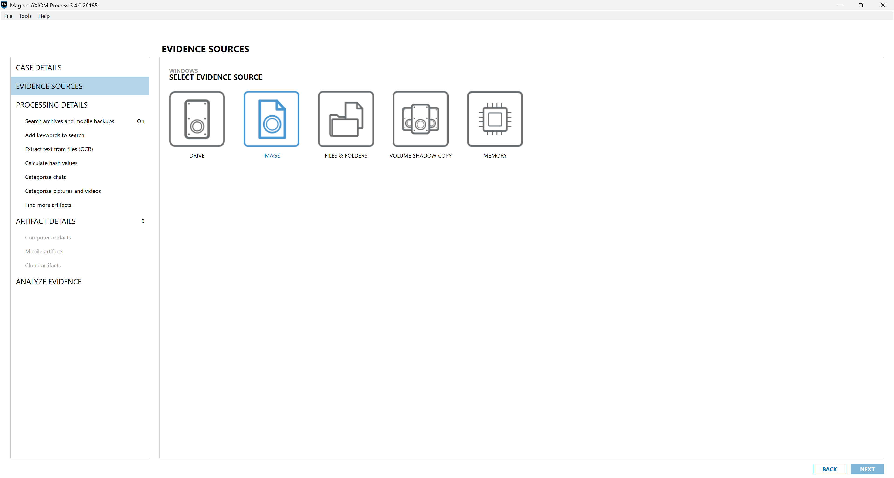
*Source type — **Image** (the raw memory file is added as an image).*


*`forensic.raw` added — "Entire Disk (18.75 GB) — No known file system found," as expected for a RAM image.*

Because AXIOM found **no known file system** (expected for a RAM image), the search type was set to **Sector level** — AXIOM treats the image as raw physical media and carves across every sector.

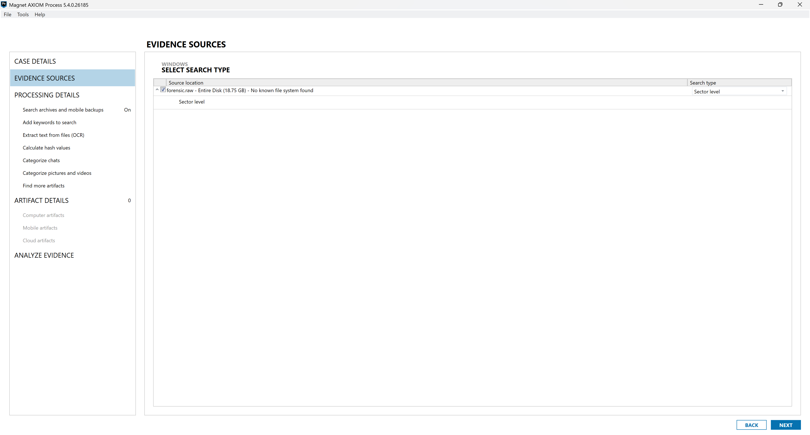
*Search type — **Sector level**, so every sector of the raw image is carved.*

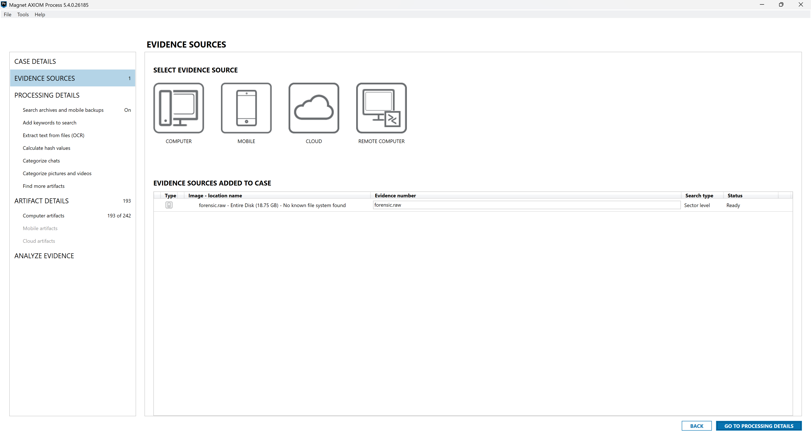
*Evidence source added — `forensic.raw` listed with status **Ready**.*

## Step 3 — Processing details

Configured processing options including:

- **Search archives and mobile backups**: On
- Add keywords to search
- Extract text from files (OCR)
- Calculate hash values
- Categorize chats (Magnet.AI)
- Categorize pictures and videos
- Find more artifacts (Dynamic App Finder)

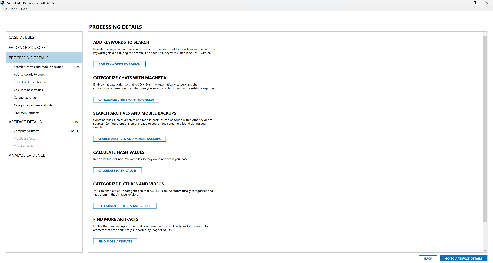
*Processing options — hashing, OCR, Magnet.AI categorization, and Dynamic App Finder enabled.*

## Step 4 — Artifact selection

Enabled a broad set of **computer artifact** categories so AXIOM would parse every relevant data type. Final selection: **221 of 242** computer artifact types, spanning:

| Category | Enabled |
|---|---|
| Additional Sources | 4 / 4 |
| Application Usage | 7 / 7 |
| Cloud Storage | 6 / 6 |
| Communication | 36 / 36 |
| Connected Devices | 8 / 8 |
| Custom Artifacts | 5 / 5 |
| Documents | 17 / 17 |
| Email & Calendar | 14 / 14 |
| Encryption & Credentials | 5 / 5 |
| Location & Travel | 1 / 1 |
| Media | 12 / 12 |
| Operating System | 67 / 67 |
| Peer to Peer | 11 / 11 |
| Social Networking | 9 / 9 |
| Web Related | 19 / 19 |

> The **Memory** category (0 of 21) was left at default; the sector-level carve across the raw image still surfaced memory-resident web, media, and OS artifacts directly.

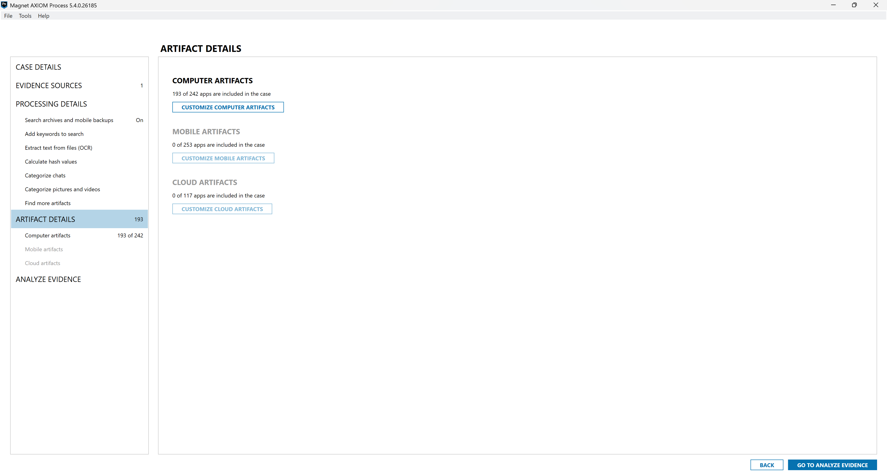
*Artifact details overview — computer artifacts enabled for the case.*

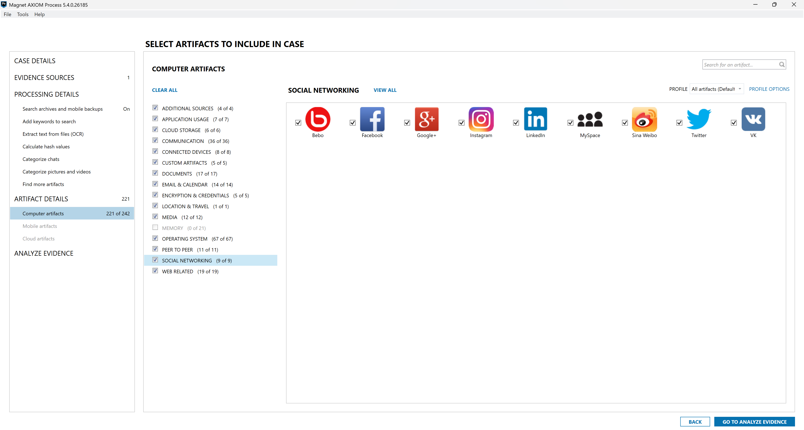
*Granular artifact selection — 221 of 242 computer artifact types enabled.*

## Step 5 — Analyze

Started the scan on the single source.

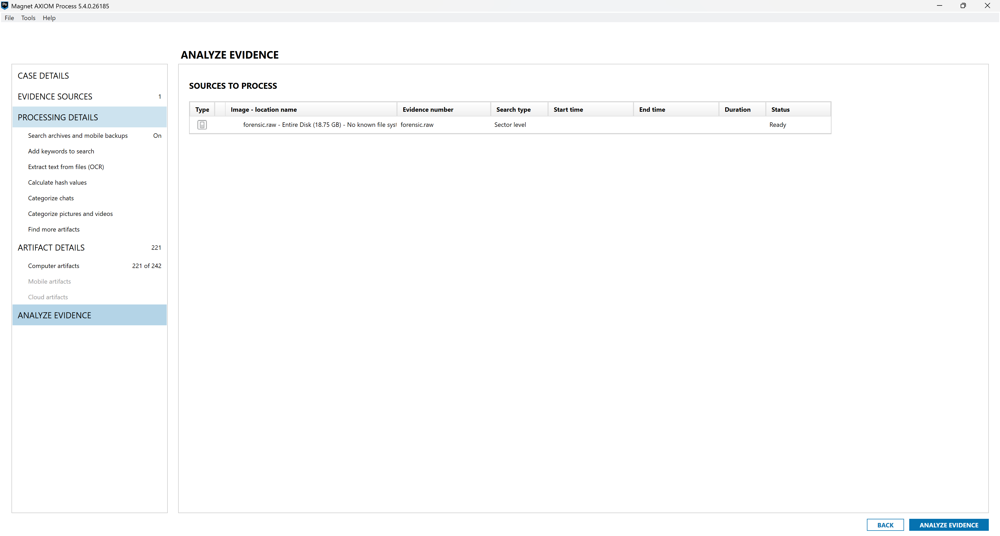
*Sources to process — the single `forensic.raw` evidence item, ready to analyze.*

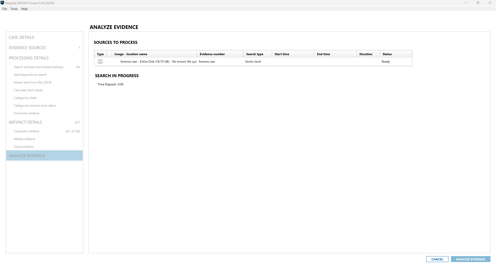
*Sector-level search running against the raw image.*

### Processing result

| Metric | Value |
|---|---|
| Search type | Sector level |
| Start time | 25-May-2025 21:38:23 |
| End time | 25-May-2025 21:50:49 |
| **Search duration** | **12 minutes, 3 seconds** |
| Indexing duration | 0 seconds |
| Outcome | **Completed** |
| Exceptions | **0** |

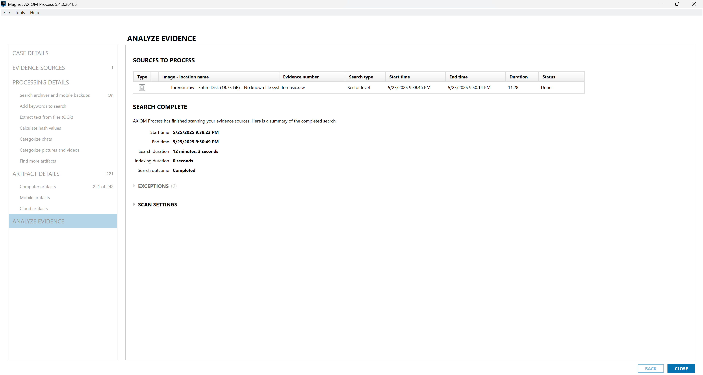
*Search complete — 12m 03s, outcome Completed, 0 exceptions.*

On completion AXIOM Process handed off to **AXIOM Examine** for analysis.

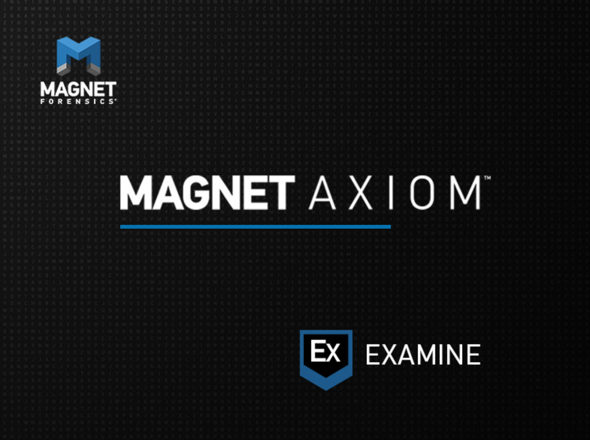
*Handoff to Magnet AXIOM Examine for artifact analysis.*

> ➡️ Next: [04 — Findings & Analysis](04-findings-and-analysis.md)
