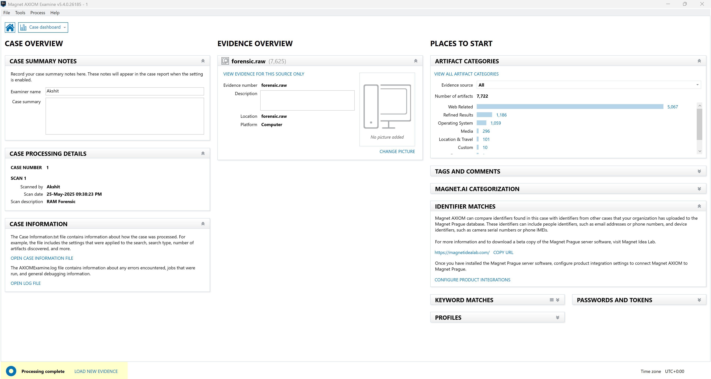
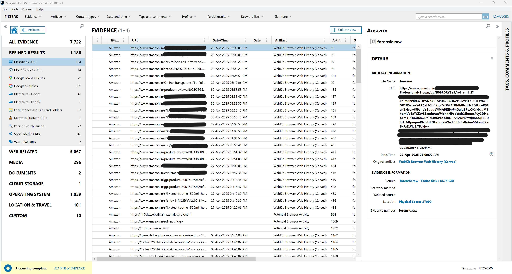
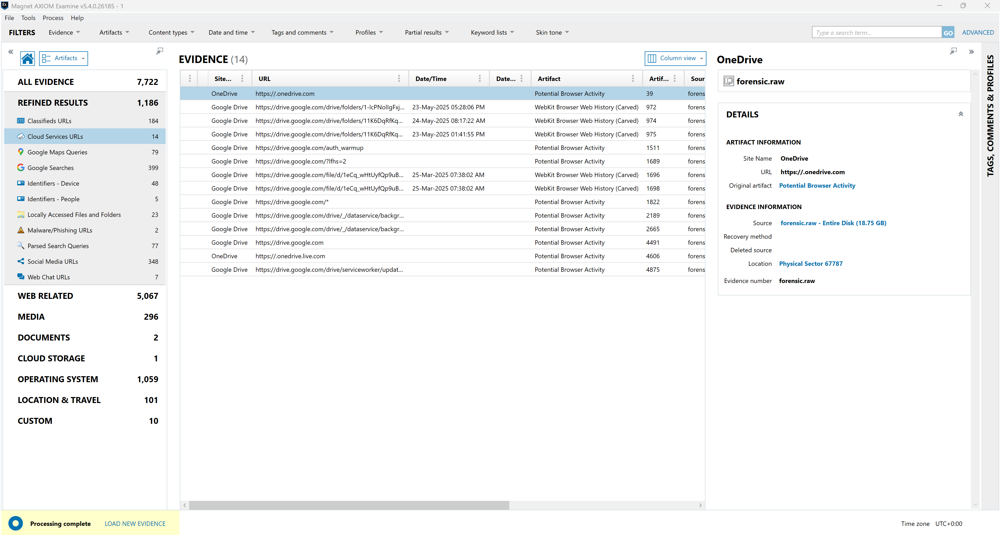
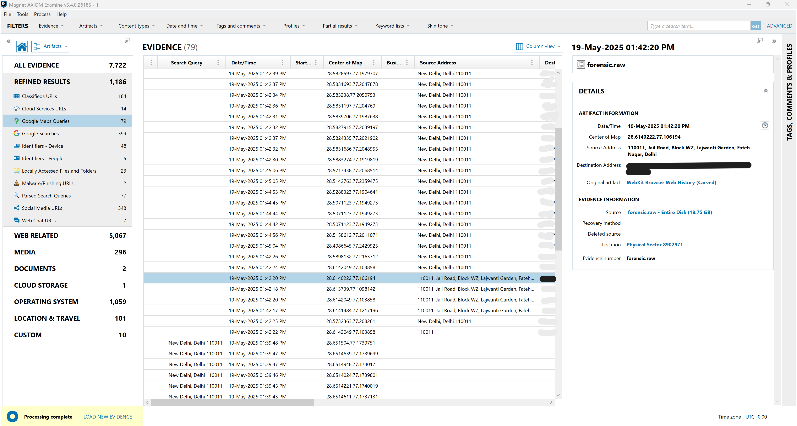
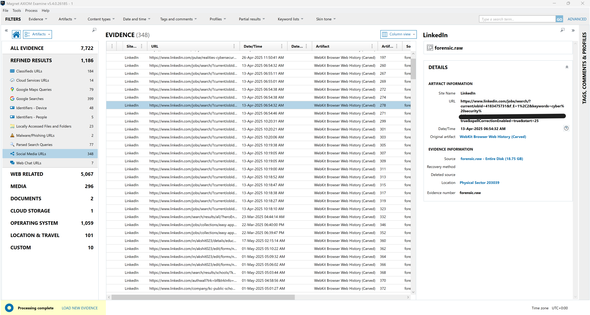
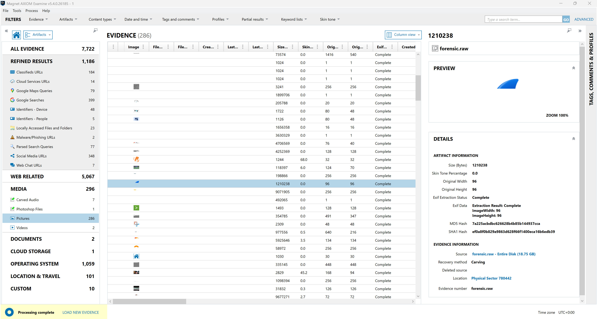
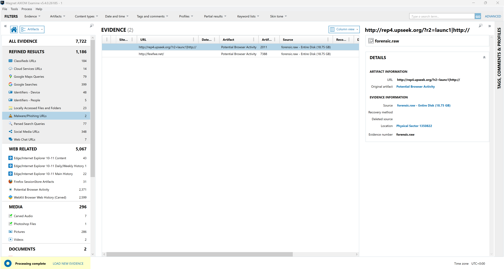

# 04 — Findings & Analysis

Analysis was performed in **Magnet AXIOM Examine v5.4.0.26185**. The case dashboard reported **7,722 total artifacts** from the single `forensic.raw` source.

*Case dashboard — 7,722 artifacts, led by Web Related (5,067).*

## Artifact category totals

| Category | Count |
|---|---:|
| Web Related | 5,067 |
| Refined Results | 1,186 |
| Operating System | 1,059 |
| Media | 296 |
| Location & Travel | 101 |
| Custom | 10 |
| **Total** | **7,722** |

---

## 1. Web activity reconstruction (5,067)

The single largest evidence class. Browser history and session data were **carved from unallocated memory**, demonstrating that activity persists in RAM well beyond what a live browser UI shows.

| Web source | Count |
|---|---:|
| WebKit Browser Web History (Carved) | 2,599 |
| Potential Browser Activity | 2,371 |
| Edge / IE 10–11 Content | 43 |
| Firefox SessionStore Artifacts | 31 |
| Edge / IE 10–11 Main History | 22 |
| Edge / IE 10–11 Daily/Weekly History | 1 |

**Classified URLs (184)** — e-commerce and service URLs with full timestamps and physical-sector offsets. Example artifact: an Amazon product/history URL carved from *Physical Sector 27090*, including AWS console session URLs (`*.signin.aws.amazon.com/sessions/*`).

*Classified URLs (184) — carved browser history with timestamps and physical-sector offsets.*

**Google Searches (399)** and **Parsed Search Queries (77)** reconstructed user search intent directly from memory.

---

## 2. Cloud-storage access (14)

Cloud service URLs recovered from memory indicate interaction with **Google Drive** and **OneDrive**:

- `drive.google.com/drive/folders/...` — specific Drive folder access with timestamps
- `drive.google.com/file/d/...` — individual file references
- `*.onedrive.com` / `onedrive.live.com`

These are high-value in a data-exfiltration case: they evidence **cloud upload/download channels** that may not be fully logged on disk.

*Cloud services URLs (14) — Google Drive folder/file access and OneDrive endpoints.*

---

## 3. Geolocation intelligence (79)

**Google Maps Queries** yielded 79 geolocation artifacts with latitude/longitude pairs, timestamps, and resolved source addresses — clustering around **New Delhi, Delhi 110011** (e.g., *Jail Road, Block WZ, Lajwanti Garden, Fateh Nagar*).

This establishes **location and movement context** for the user session, reconstructed entirely from volatile memory.

*Google Maps queries (79) — coordinates and resolved addresses clustering around New Delhi 110011.*

---

## 4. Social-media activity (348)

Social media URLs were dominated by **LinkedIn** activity — job searches (`/jobs/search/?currentJobId=...`), profile edits (`/in/<user>/edit/...`), and company/search result pages, with keyword context such as `keywords=cyber%20security`. Timestamps allow a behavioral timeline of the session.

*Social media URLs (348) — predominantly LinkedIn job-search and profile activity.*

---

## 5. Recovered media (296)

Media was recovered through **carving** from physical sectors, each artifact hashed (MD5/SHA-1) with EXIF extraction where available:

| Type | Count |
|---|---:|
| Pictures | 286 |
| Carved Audio | 7 |
| Videos | 2 |
| Photoshop Files | 1 |

Example: a carved image at *Physical Sector 780442*, recovery method **Carving**, with full MD5/SHA-1 hashes and EXIF dimensions.

*Recovered pictures (286) — carved from physical sectors with MD5/SHA-1 hashing and EXIF extraction.*

---

## 6. Other refined results

| Artifact | Count | Note |
|---|---:|---|
| Identifiers – Device | 48 | Device-level identifiers |
| Locally Accessed Files and Folders | 23 | File-interaction evidence |
| Web Chat URLs | 7 | Chat/messaging fragments |
| Identifiers – People | 5 | Email / person identifiers |
| Documents | 2 | In-memory document remnants |
| Cloud Storage | 1 | Cloud sync/storage artifact |

---

## 7. Malware / phishing URLs (2)

Two memory-resident suspicious URLs were flagged — see dedicated analysis in **[05 — Indicators of Compromise](05-indicators-of-compromise.md)**.

*Malware / phishing URLs (2) — suspicious indicators resident in volatile memory.*

---

## Analytical takeaways

- **RAM retains browser activity far beyond the live session** — carved WebKit history (2,599) and potential browser activity (2,371) together dwarf what a running browser exposes.
- **Historical persistence** — timestamps span **March–May 2025**, showing that browser artifacts, autocomplete data, and prior-session remnants survive in memory due to caching and incomplete cleanup.
- **Cross-channel reconstruction** — web, cloud, geolocation, and social evidence were correlated into a single behavioral timeline from one volatile source.
- **No-disk-footprint evidence** — in-memory documents, cached media, and suspicious URLs would be lost in a disk-only investigation.

> ➡️ Next: [05 — Indicators of Compromise](05-indicators-of-compromise.md)
